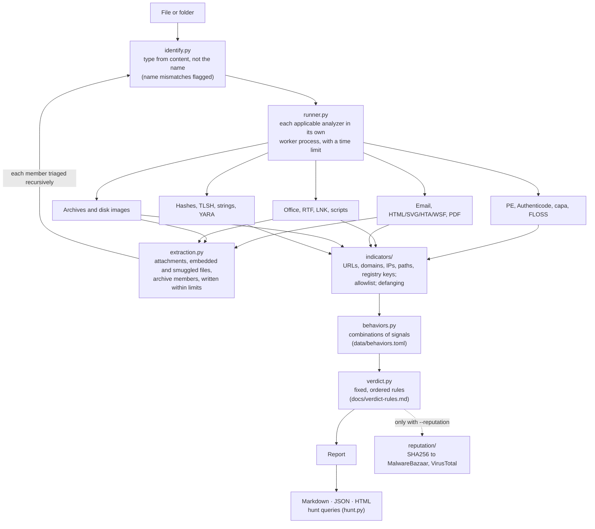

# Architecture

unopened is a pipeline: identify the file, run every analyzer that applies, triage
whatever they extract the same way, then turn the combined evidence into a verdict and
a report. Every stage is static. Nothing runs, renders or opens the sample.

## Stages

| Stage | Module | What it guarantees |
|---|---|---|
| Identification | `identify.py` | The type comes from magic bytes and structure. The file name is only compared against it, which is how `invoice.pdf.lnk` and a program named `.docx` get flagged. |
| Analyzer runs | `runner.py`, `analyzers/` | Each analyzer runs in a forked worker with its own time limit, so a parser that hangs or crashes on a hostile file costs one check, not the run. Every result has a status (OK, PARTIAL, ERROR, TIMEOUT, UNAVAILABLE), and anything other than OK is shown near the top of the report. |
| Extraction | `extraction.py`, `safezip.py` | Members are written under index names (`0001.bin`) in a private temporary directory, with limits on depth, count, total size, per-member size and compression ratio, checked against the headers and again as bytes arrive. |
| Recursion | `pipeline.py` | Every extracted member goes back through the whole pipeline. A container takes the most severe verdict among its own findings and its members. |
| Indicators | `indicators/` | Analyzers hand over decoded text (macro source, shortcut arguments, deobfuscated scripts, links); extraction, validation against a TLD list, the allowlist and defanging happen in one place. |
| Behaviors | `behaviors.py` | Combinations that mean more than their parts, for example "drops an embedded program and runs it", defined in an editable TOML file. |
| Verdict | `verdict.py` | Ordered rules with stable IDs. The first match sets the verdict; every match is listed with its evidence. The rule table in the docs is generated from the code and CI checks it is current. |
| Output | `report/`, `hunt.py` | Markdown is the source of the human-readable formats: the HTML page is built from it, so it inherits the defanging. JSON carries raw values only in fields named `raw`. |
| Reputation | `reputation/` | The only module allowed to touch the network, imported only with `--reputation`, and it sends SHA256 hashes only. |

## How the rules are enforced

The safety rules in [CLAUDE.md](../CLAUDE.md) are checked by tests, not left to review:

- `tests/test_safety.py` parses every source file and fails on process-spawning,
  dynamic-code and network imports outside `reputation/transport.py`.
- `tests/conftest.py` blocks sockets, DNS and process creation for the whole test run,
  in the forked analyzer workers too.
- `tests/test_fuzz.py` damages every fixture in seeded ways and runs it through the
  pipeline and all three writers: no crash, and no check may fail without the report
  saying so.
- `tests/test_verdict.py` drives every verdict rule with a synthetic case and keeps
  `docs/verdict-rules.md` in sync with the code.

## Adding an analyzer

1. Write `analyzers/<name>.py` with a function `analyze_<name>(ctx) -> AnalyzerOutput`.
   Put findings in `out.findings` (stable IDs such as `rtf.objupdate`), problems in
   `out.errors` (the result becomes PARTIAL) and skipped work in `out.not_checked`.
2. Register it in `analyzers/__init__.py` with the file kinds it applies to and the
   optional libraries it needs; a missing library becomes UNAVAILABLE, never a crash.
3. If it extracts files, use `MemberWriter` and add its name to `MEMBER_SOURCES` in
   `pipeline.py`, so members are triaged and charged to the shared limits.
4. Add a verdict rule only for evidence that is specific on its own, with a case in
   `tests/test_verdict.py`, then regenerate `docs/verdict-rules.md`.
5. Build synthetic fixtures in `tests/fixtures/`, including benign look-alikes that must
   stay quiet, and add them to the fuzz seeds.
